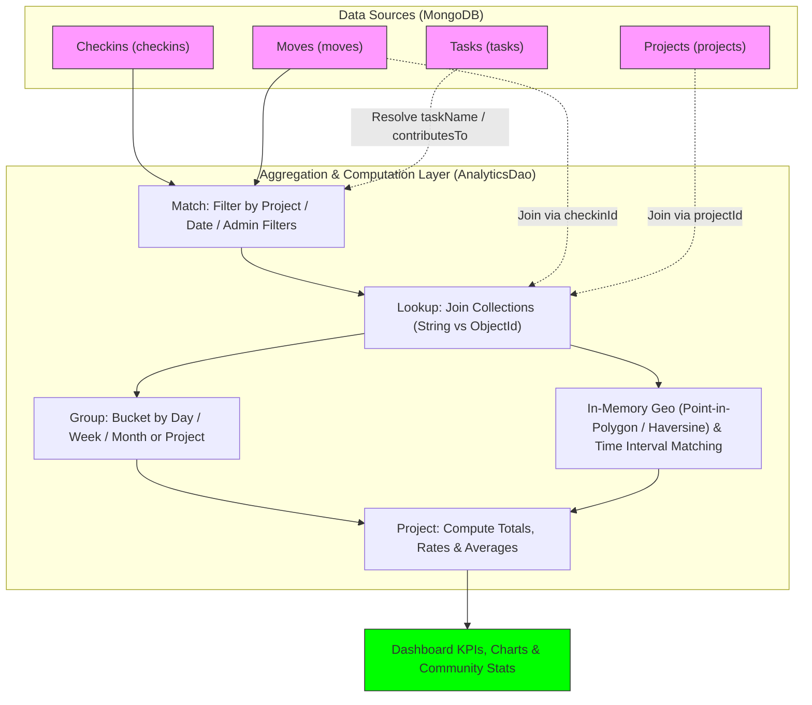

# Analytics & Queries



# Analytics Data Extraction Guide (MongoDB)

This document explains how data is extracted from MongoDB to power the Rayuela Analytics Dashboard (`/admin/analytics`) and per-project Community Statistics. It details the aggregation pipelines, technical constraints, and data modeling strategies used in `AnalyticsDao` (`src/module/analytics/analytics.dao.ts`).

All analytics endpoints are protected by `JwtAuthGuard` and `RolesGuard` and restricted to `UserRole.Admin`.

---

## 1. Data Model Overview

The analytics engine queries four primary MongoDB collections:

- **Checkins (`checkins`)**: Recorded observations when a volunteer performs field data collection.
  - Key fields: `_id` (ObjectId), `userId` (String), `projectId` (String), `datetime` (Date), `latitude` (String), `longitude` (String), `taskType` (String), `contributesTo` (String — ID of the solved Task, or `""` if the check-in did not satisfy any specific task), `imageRefs` (String[]).
- **Moves (`moves`)**: Gamification events evaluated and persisted upon each check-in.
  - Key fields: `checkinId` (String), `timestamp` (Date), `newPoints` (Number), `newBadges` (String[] — badge names unlocked during that check-in).
- **Projects (`projects`)**: Configuration and spatial/temporal context for check-ins.
  - Key fields: `_id` (ObjectId), `name`, `timezone`, `areas` (GeoJSON `FeatureCollection`), `timeIntervals` (Array of `TimeInterval`), `taskTypes`, `gamificationStrategy`, `recommendationStrategy`, `leaderboardStrategy`.
- **Tasks (`tasks`)**: Project missions/tasks with spatial, temporal, and task-type constraints.
  - Key fields: `_id` (ObjectId), `projectId` (ObjectId/String), `name`, `description`.

---

## 2. Technical Constraints & Helpers

### 2.1 MongoDB Version Compatibility (`buildDateBucket`)
To ensure compatibility across MongoDB versions without relying on `$dateTrunc` (which requires MongoDB 5.0+), `AnalyticsDao` uses a custom `buildDateBucket(granularity, field)` helper that buckets timestamps by `'day'`, `'week'` (ISO Monday), or `'month'` using `$dateToString` and `$dateFromParts`:

```javascript
// Day: "%Y-%m-%d"
{ $dateToString: { format: "%Y-%m-%d", date: "$datetime" } }

// Week: ISO Monday start date
{
  $dateFromParts: {
    isoWeekYear: { $isoWeekYear: "$datetime" },
    isoWeek: { $isoWeek: "$datetime" },
    isoDayOfWeek: 1
  }
}

// Month: First day of the month "%Y-%m-01"
{ $dateToString: { format: "%Y-%m-01", date: "$datetime" } }
```

### 2.2 Type Mismatch Handling (`lookupByStringId`)
In the Rayuela schema, foreign keys such as `projectId` (on `checkins`) and `checkinId` (on `moves`) are stored as `String`, whereas the target `_id` in `projects` and `checkins` is an `ObjectId`. Standard `localField` / `foreignField` `$lookup` stages fail silently when comparing `ObjectId` to `String`.

**Helper: `lookupByStringId(from, localField, as)`**
Uses an expressive `$lookup` pipeline with `$toString` to coerce `_id` before matching:

```javascript
{
  $lookup: {
    from: "projects",
    let: { refId: "$projectId" },
    pipeline: [
      { $match: { $expr: { $eq: [{ $toString: "$_id" }, "$$refId"] } } }
    ],
    as: "project"
  }
}
```

### 2.3 Date Range Filtering (`dateRangeMatch` & `buildDateFilter`)
When `startDate` and/or `endDate` query parameters are supplied:
- `startDate` sets `$gte: new Date(startDate)`.
- `endDate` sets `$lte` to the end of that UTC day (`end.setUTCHours(23, 59, 59, 999)`), ensuring full-day inclusion for ISO date strings (`YYYY-MM-DD`).

---

## 3. Core Aggregation Pipelines & Endpoints

### 3.1 Summary KPIs
- **Endpoint**: `GET /v1/analytics/summary`
- **Query Params**: `projectId?`, `startDate?`, `endDate?`
- **Return Type**: `SummaryStats`
- **Goal**: Power the 5 top-level KPI summary cards on the Analytics Dashboard.

**Execution**:
Runs four queries in parallel via `Promise.all` plus `contributionRate(projectId)`:
1. **`totalCheckins`**: `checkinModel.countDocuments(baseMatch)` filtered by `projectId` and `datetime`.
2. **`totalActiveUsers`**: `checkinModel.distinct('userId', baseMatch).length` (unique users with at least 1 check-in in the filtered window).
3. **`totalBadgesEarned`**: Aggregates `moves` (filtered by `timestamp` and joined to `checkins` when `projectId` is present), unwinds `$newBadges`, and counts total badges awarded (`$count: 'total'`).
4. **`totalPointsAwarded`**: Aggregates `moves` (filtered by `timestamp` and optional `projectId` join) and sums `$newPoints` (`$sum: '$newPoints'`).
5. **`overallContributionRate`**: Aggregates `contributionRate(projectId)` across matching projects and computes $\frac{\sum \text{withContribution}}{\sum \text{total}}$ (or `0` when `totalAll === 0`). *(Note: `overallContributionRate` currently delegates to `contributionRate(projectId)`, which does not filter by `startDate`/`endDate`).*

---

### 3.2 Check-ins Over Time
- **Endpoint**: `GET /v1/analytics/checkins-over-time`
- **Query Params**: `projectId?`, `granularity = 'week'` (`'day' | 'week' | 'month'`), `startDate?`, `endDate?`
- **Return Type**: `TimeSeries[]` (`{ period: string, count: number }`)
- **Goal**: Count check-ins grouped by the selected time bucket.

```javascript
[
  { $match: { projectId: "..." } }, // Optional (when projectId is provided)
  { $match: { datetime: { $gte: ISODate("..."), $lte: ISODate("...") } } }, // Optional
  {
    $group: {
      _id: buildDateBucket(granularity, "datetime"),
      count: { $sum: 1 }
    }
  },
  { $sort: { _id: 1 } },
  { $project: { _id: 0, period: "$_id", count: 1 } }
]
```

---

### 3.3 Active Users Over Time
- **Endpoint**: `GET /v1/analytics/active-users-over-time`
- **Query Params**: `projectId?`, `granularity = 'week'`, `startDate?`, `endDate?`
- **Return Type**: `ActiveUsersSeries[]` (`{ period: string, uniqueUsers: number }`)
- **Goal**: Count distinct `userId`s submitting check-ins per time bucket.

```javascript
[
  { $match: { ... } }, // Optional projectId and datetime filters
  {
    $group: {
      _id: {
        period: buildDateBucket(granularity, "datetime"),
        userId: "$userId"
      }
    }
  },
  {
    $group: {
      _id: "$_id.period",
      uniqueUsers: { $sum: 1 }
    }
  },
  { $sort: { _id: 1 } },
  { $project: { _id: 0, period: "$_id", uniqueUsers: 1 } }
]
```

---

### 3.4 Points Awarded Over Time
- **Endpoint**: `GET /v1/analytics/points-over-time`
- **Query Params**: `projectId?`, `granularity = 'week'`, `startDate?`, `endDate?`
- **Return Type**: `PointsSeries[]` (`{ period: string, totalPoints: number, avgPointsPerCheckin: number }`)
- **Goal**: Track total gamification points awarded and average points per check-in over time.

```javascript
[
  { $match: { timestamp: { $gte: ISODate("..."), $lte: ISODate("...") } } }, // Optional
  // Included only when projectId is provided:
  lookupByStringId("checkins", "checkinId", "checkin"),
  { $unwind: "$checkin" },
  { $match: { "checkin.projectId": projectId } },
  {
    $group: {
      _id: buildDateBucket(granularity, "timestamp"),
      totalPoints: { $sum: "$newPoints" },
      checkinCount: { $sum: 1 }
    }
  },
  { $sort: { _id: 1 } },
  {
    $project: {
      _id: 0,
      period: "$_id",
      totalPoints: 1,
      avgPointsPerCheckin: {
        $cond: [
          { $eq: ["$checkinCount", 0] },
          0,
          { $divide: ["$totalPoints", "$checkinCount"] }
        ]
      }
    }
  }
]
```

---

### 3.5 Badge Acquisition Over Time
- **Endpoint**: `GET /v1/analytics/badge-acquisition-over-time`
- **Query Params**: `projectId?`, `granularity = 'week'`, `startDate?`, `endDate?`
- **Return Type**: `TimeSeries[]` (`{ period: string, count: number }`)
- **Goal**: Count how many badges were unlocked across `moves` per time bucket.

```javascript
[
  { $match: { timestamp: { $gte: ISODate("..."), $lte: ISODate("...") } } }, // Optional
  // Included only when projectId is provided:
  lookupByStringId("checkins", "checkinId", "checkin"),
  { $unwind: "$checkin" },
  { $match: { "checkin.projectId": projectId } },
  { $unwind: "$newBadges" },
  {
    $group: {
      _id: buildDateBucket(granularity, "timestamp"),
      count: { $sum: 1 }
    }
  },
  { $sort: { _id: 1 } },
  { $project: { _id: 0, period: "$_id", count: 1 } }
]
```

---

### 3.6 Strategy Breakdown (Per-Project Strategy Comparison)
- **Endpoint**: `GET /v1/analytics/by-strategy`
- **Query Params**: None (always evaluates all projects across all time)
- **Return Type**: `StrategyBreakdown[]`
- **Goal**: Compare project activity (`checkinCount`, `avgPointsPerCheckin`, `activeUsers`) alongside each project's configured `gamificationStrategy` (`SIN ADAPTACION`, `ELASTICA`, `DESVANECIMIENTO`), `recommendationStrategy`, and `leaderboardStrategy`.

> **Note on Grouping & Dashboard Rendering**: Although the endpoint is named `/by-strategy`, the pipeline groups by **`$projectId`** (`_id: '$projectId'`), returning one row per project with its strategy metadata attached. On the frontend dashboard (`AnalyticsDashboard.vue`), the X-axis displays `projectName` while `gamificationStrategy` is used to color-code the bars.

```javascript
[
  lookupByStringId("projects", "projectId", "project"),
  { $unwind: "$project" },
  {
    $lookup: {
      from: "moves",
      let: { cid: { $toString: "$_id" } },
      pipeline: [{ $match: { $expr: { $eq: ["$checkinId", "$$cid"] } } }],
      as: "move"
    }
  },
  { $unwind: { path: "$move", preserveNullAndEmptyArrays: true } },
  {
    $group: {
      _id: "$projectId",
      projectName: { $first: "$project.name" },
      gamificationStrategy: { $first: "$project.gamificationStrategy" },
      recommendationStrategy: { $first: "$project.recommendationStrategy" },
      leaderboardStrategy: { $first: "$project.leaderboardStrategy" },
      checkinCount: { $sum: 1 },
      totalPoints: { $sum: { $ifNull: ["$move.newPoints", 0] } },
      users: { $addToSet: "$userId" }
    }
  },
  {
    $project: {
      _id: 0,
      projectId: "$_id",
      projectName: 1,
      gamificationStrategy: 1,
      recommendationStrategy: 1,
      leaderboardStrategy: 1,
      checkinCount: 1,
      avgPointsPerCheckin: {
        $cond: [
          { $eq: ["$checkinCount", 0] },
          0,
          { $divide: ["$totalPoints", "$checkinCount"] }
        ]
      },
      activeUsers: { $size: "$users" }
    }
  }
]
```

---

### 3.7 Contribution Rate by Project
- **Endpoint**: `GET /v1/analytics/contribution-rate`
- **Query Params**: `projectId?`
- **Return Type**: `ContributionRate[]` (`{ projectId, projectName, total, withContribution, rate }`)
- **Goal**: Measure the proportion of check-ins that satisfied and solved a project **Task (mission)** (`contributesTo` is non-empty) versus general/free check-ins (`contributesTo === ""`).

**What "Contribution Rate" Means**:
When a volunteer submits a check-in (`CheckinService.create`), the backend evaluates whether the observation's coordinates, timestamp, and `taskType` satisfy any active Task in the project (`t.contributesToCheckin(checkin)`). If matched, `checkin.contributesTo` stores the solved Task's ID; otherwise it defaults to `""`.
Therefore, `rate` ($\in [0, 1]$) represents the **task-completion ratio of check-ins** ($\frac{\text{withContribution}}{\text{total}}$), **not** the percentage of registered users who contributed.

```javascript
[
  { $match: { projectId: "..." } }, // Optional
  {
    $group: {
      _id: "$projectId",
      total: { $sum: 1 },
      withContribution: {
        $sum: {
          $cond: [{ $gt: [{ $strLenCP: "$contributesTo" }, 0] }, 1, 0]
        }
      }
    }
  },
  {
    $lookup: {
      from: "projects",
      let: { pid: "$_id" },
      pipeline: [
        { $match: { $expr: { $eq: [{ $toString: "$_id" }, "$$pid"] } } }
      ],
      as: "project"
    }
  },
  { $unwind: "$project" },
  {
    $project: {
      _id: 0,
      projectId: "$_id",
      projectName: "$project.name",
      total: 1,
      withContribution: 1,
      rate: {
        $cond: [
          { $eq: ["$total", 0] },
          0,
          { $divide: ["$withContribution", "$total"] }
        ]
      }
    }
  }
]
```

---

### 3.8 Project Community Statistics (`community-stats`)
- **Endpoint**: `GET /v1/analytics/project/:projectId/community-stats`
- **Query Params**: `AdminCheckinQueryDto` (`taskName?`, `taskType?`, `badgeName?`, `userId?`, `hasPhotos?`, `contributed?`, `dateFrom?`, `dateTo?`, `latitude?`, `longitude?`, `radiusKm?`)
- **Return Type**: `CommunityStats` (`{ byArea: AreaStat[], byTaskType: TaskTypeStat[], byInterval: IntervalStat[] }`)
- **Goal**: Build per-project community breakdowns grouped by **GeoJSON Area**, **Task Type**, and **Time Interval**, while honoring the same multi-dimensional filters used by the Admin Check-ins view.

**Pipeline & In-Memory Aggregation Steps**:
1. **Project Lookup**: Loads the target `ProjectDocument` (404 if not found) to inspect its `areas.features` polygons, `timeIntervals`, and `timezone`.
2. **Mongo Pre-Filtering (`buildCommunityStatsFilter`)**:
   - Filters by `projectId`, `taskType`, `userId`, `hasPhotos` (`imageRefs.0`), `contributed` (`contributesTo`), and `dateFrom`/`dateTo`.
   - **`badgeName` filter**: Queries `moves` where `newBadges` matches `badgeName` and restricts `checkins._id` to the resulting `checkinId` list (converting string IDs to `Types.ObjectId` so Mongoose does not cast-fail or miss ObjectId `_id`s).
   - **`taskName` filter**: Pushes a case-insensitive regex query down to the `tasks` collection (`name` or `description`) and restricts `checkins.contributesTo` to matching task IDs.
   - Short-circuits with `{ byArea: [], byTaskType: [], byInterval: [] }` if `badgeName` or `taskName` matches zero records.
3. **Haversine Geo-Radius Filter (`applyGeoRadiusFilter`)**:
   - When `latitude`, `longitude`, and `radiusKm > 0` are provided, narrows the matched check-ins in memory using the Haversine great-circle distance formula ($R = 6371\text{ km}$).
4. **Move Enrichment & Spatial/Temporal Attribution (`buildCommunityStatsResult`)**:
   - Batch-loads associated `Move` documents (`checkinId: { $in: checkinIds }`) into a lookup `Map`.
   - **By Area (`byArea`)**: Tests each check-in's `(longitude, latitude)` against every polygon in `project.areas.features` via `GeoUtils.isPointInPolygon`. Attributes `checkinsCount`, `totalPoints` (`move.newPoints`), and `totalBadges` (`move.newBadges.length`) to the first matching area, or to `"Outside Area"` (`"Fuera de Área"`) if none match.
   - **By Task Type (`byTaskType`)**: Counts check-ins per `ch.taskType` (fallback `"Unknown"`).
   - **By Time Interval (`byInterval`)**: Evaluates `TimeInterval.satisfy(ch.datetime)` (respecting interval/project timezone) and counts check-ins per interval name, or `"Cualquiera"` when no configured interval matches.

---

## 4. Conceptual Execution

To understand how the MongoDB aggregation queries work, let's take **Check-ins Over Time** as an example of the `Filter -> Transform -> Aggregate` flow:

1. **Filtering (`$match`)**: The database first narrows down the documents. Instead of scanning all check-ins, it only keeps those belonging to a specific `projectId` or within a `startDate`/`endDate` range. **Conceptual thought: "Only give me check-ins from Project A in the selected window."**
2. **Bucketization (`$group._id`)**: The query inspects each check-in's `datetime` (e.g., `2026-05-15T14:30:00Z`) and truncates it into a calendar bucket via `buildDateBucket`. If the granularity is `"month"`, every check-in in May 2026 receives the same group key: `"2026-05-01"`. **Conceptual thought: "Put every check-in into a box labeled with its month."**
3. **Counting (`$sum: 1`)**: Once the buckets are formed, MongoDB counts how many check-ins fall inside each bucket. **Conceptual thought: "Count the items in each box."**
4. **Sorting & Projection (`$sort`, `$project`)**: Finally, the buckets are ordered chronologically and renamed from `_id` to `period` so the dashboard can plot a continuous time series.

---

## 5. Performance Analysis & Warnings

As the platform scales to **thousands or millions of records**, certain queries will degrade significantly. Developers should be aware of the following bottlenecks:

### 5.1 The "Cross-Collection" Penalty (`$lookup`)
Queries like **Points Over Time**, **Badge Acquisition Over Time**, and **Summary** (when `projectId` is specified) must join `moves` to `checkins` via `lookupByStringId` because `moves` do not store `projectId` directly.
- **Risk**: If there are 1 million `moves` in the date range, MongoDB performs an uncorrelated `$lookup` sub-pipeline with `$toString: "$_id"` against `checkins` for each move.
- **Mitigation**: Keep `checkinId` indexed in `moves` and `projectId` + `datetime` indexed in `checkins`, or denormalize `projectId` onto `MoveTemplate`.

### 5.2 Array Expansion Memory Overhead (`$unwind`)
The **Badge Acquisition Over Time** and **Summary (`totalBadgesEarned`)** queries use `$unwind: "$newBadges"`.
- **Risk**: If a user unlocks multiple badges in a single check-in, `$unwind` multiplies that document in memory.
- **Degradation**: Across hundreds of thousands of moves, intermediate document expansion increases memory pressure toward MongoDB's 100MB stage limit.

### 5.3 Double-Grouping Bottleneck
**Active Users Over Time** groups data twice: first by `{ period, userId }` to deduplicate users per bucket, and then by `$_id.period` to count unique users.
- **Risk**: The first `$group` materializes a distinct entry for every `(user, period)` pair.

### 5.4 In-Memory Geo & Interval Scan (`communityStats`)
`communityStats` loads matching project check-ins and their moves into Node.js memory to run ray-casting point-in-polygon (`GeoUtils.isPointInPolygon`), Haversine distance filtering, and timezone-aware `TimeInterval.satisfy()` checks.
- **Risk**: For a single project with tens of thousands of check-ins and complex multi-ring GeoJSON polygons, CPU time in the Node.js event loop grows linearly with $\text{checkins} \times (\text{areas} + \text{intervals})$.

### 5.5 Recommendation for Massive Scale
If the dataset grows to millions of records, consider **Pre-aggregation (Materialized Views)** or denormalization:
- Store `projectId` directly on `moves` documents to eliminate cross-collection `$lookup` stages.
- Maintain a daily/hourly pre-aggregated stats collection updated asynchronously on check-in creation.
